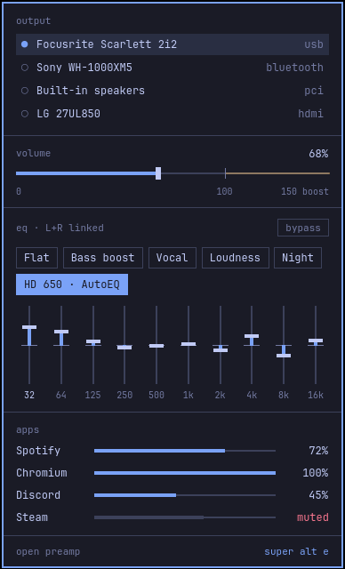
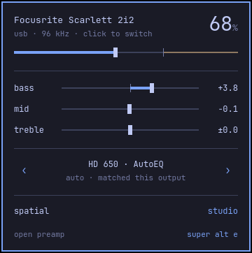

# preamp

[](docs/preamp.mp4)

preamp is a system audio equalizer for [Omarchy](https://omarchy.org). Every app plays through it into your speakers or headphones. Pick a preset from the bar, shape ten bands in the window, or load a correction curve for your headphones. The window and the bar widget follow your Omarchy theme, rounding and language.

To see it with sound, watch the [25-second video](docs/preamp.mp4).

## Install

You need Omarchy with the Omarchy shell, PipeWire and WirePlumber.

To install the release package:

```sh
curl -LO https://github.com/bjarneo/preamp/releases/download/v0.1.0/preamp-0.1.0-1-x86_64.pkg.tar.zst
sudo pacman -U preamp-0.1.0-1-x86_64.pkg.tar.zst
systemctl --user enable --now preamp.service
preamp shell install
```

`pacman` installs the dependencies. The service starts now and at each login. The last command puts the preamp widget on the Omarchy bar.

To build from source instead:

```sh
git clone https://github.com/bjarneo/preamp.git
cd preamp
./bin/install
```

`bin/install` builds the package with `makepkg`, installs it, starts the service and puts the widget on the bar.

To open the window with `SUPER ALT E`, add this line to `~/.config/hypr/bindings.lua`:

```lua
o.bind("SUPER + ALT + E", "preamp", { launch = "preamp" })
```

You can also open preamp from the app launcher.

## Start in one minute

1. Click the preamp widget in the bar, then click `Bass boost`. The sound changes at once.
2. Right-click the widget to bypass the equalizer. Right-click again to hear the difference.
3. To correct your headphones, run `preamp autoeq "hd 650"` with the name of your model.
4. Press `SUPER ALT E` to open the window, then press `tab` for the detailed views.

## Features

- A ten-band parametric equalizer for each channel. Edit L and R together or apart.
- An automatic preamp. It cuts the input so that the loudest point of the curve stays at 0 dB.
- A live analyzer of the signal after the equalizer.
- Six built-in presets and your own presets. Keys `1` to `8` apply the built-in presets, then your most recent ones.
- Headphone profiles from [AutoEq](https://github.com/jaakkopasanen/AutoEq), with more than 6,000 headphones.
- LV2 and LADSPA effects after the equalizer, for example a compressor or a limiter from `lsp-plugins-lv2`.
- A room reverb, stereo width and balance.
- Volume up to 150%, and volume and mute for each app.
- Auto-switch rules. A preset can follow an output, an app in a call, or a fullscreen app.
- A notification when preamp moves to a new output.
- 50 languages, the same set as Omarchy.

## Views

The presets view is the everyday view. It shows one card for each preset with the shape of its curve, and the output and volume below the cards. Click a card or press its number to use the preset.


Press `tab` to go to the next view. Studio, Modes and Signal chain have the detailed controls. The window opens on the view you used last.

| Studio | Modes | Signal chain |
|---|---|---|
|  |  |  |
| The curve over the analyzer, the ten bands, presets and effects | Basic, graphic and parametric editing, and the command bar | Apps, equalizer, effects, room and output in the order the audio flows, and the auto-switch rules |

## Bar widget

The widget shows the preset in use. Click it for the popover. Right-click it to bypass the equalizer. Scroll on it to change the volume.

| Full popover | Quick popover |
|---|---|
|  |  |

To show the quick popover, run:

```sh
omarchy bar set preamp variant quick
```

## Keys

Press `?` in the window to show the keys for the view.

In the presets view:

| Key | Action |
|---|---|
| `h` `l` or `←` `→` | Use the previous or next preset |
| `j` `k` or `↓` `↑` | Use the preset above or below |
| `-` `+` | Decrease or increase the volume by 5% |
| `1` to `8` | Apply a preset |
| `b` | Bypass the equalizer |
| `tab` | Go to the next view |
| `q` | Quit |

In the other views:

| Key | Action |
|---|---|
| `h` `l` or `←` `→` | Select a band |
| `j` `k` or `↓` `↑` | Decrease or increase the gain of the band |
| `H` `L` | Decrease or increase the frequency of the band |
| `J` `K` | Decrease or increase the Q of the band |
| `0` | Set the gain of the band to 0 |
| `1` to `8` | Apply a preset |
| `c` | Select the channel: L+R, L or R |
| `b` | Bypass the equalizer |
| `m` | Select the next mode: basic, graphic or parametric |
| `:` | Open the command bar |
| `tab` | Go to the next view |
| `q` | Quit |

The command bar finds presets and AutoEq profiles. It also accepts these commands:

| Command | Action |
|---|---|
| `w NAME` | Save the curve as a preset |
| `rm NAME` | Delete a saved preset |
| `pin` | Apply the current preset each time this output is selected |
| `unpin` | Remove the pin from this output |

## Command line

Each command starts the audio service if it is not running. Each command exits with 0 or 1 and writes errors to stderr. Add `--json` to get the full answer of the service.

```sh
preamp status
preamp preset "Bass boost"
preamp autoeq "hd 650"
preamp band 3 --freq 125 --gain -2 --q 1.4
preamp bypass on
preamp outputs
preamp output "Laptop Speakers"
preamp volume 120
```

To teach coding agents to use these commands, run `preamp skill install`.

## How it works

The `preamp.service` user service runs `preamp daemon`. The daemon creates a PipeWire sink named `preamp` and makes it the default output. Apps play into this sink. The daemon runs the audio through the equalizer and plays it into the output that you select.

- When you select an output in the Omarchy audio panel, preamp plays into that output and stays the default.
- When you connect headphones that you used before, preamp moves to them, applies their pinned preset and shows a notification.
- The volume in preamp is the volume of the output device.
- On a laptop with an Omarchy speaker tuning, preamp plays into the tuning, so the tuning still applies.
- When the service stops, it gives the default output back to the device that it played into.

The settings are in `~/.config/preamp/config.json`. The AutoEq index is cached in `~/.cache/preamp/` for one week.

## Known issues

- On a laptop with an Omarchy speaker tuning, the Omarchy volume keys change the volume of the tuning, not of the speakers. The preamp volume and the keys then add up. If the sound is too quiet, set the volume in preamp, for example `preamp volume 60`.
- The Signal chain view needs a window that is 1096 pixels wide or more. In a narrower window, the right-hand boxes are cut off.
- The translations need a review by native speakers, mostly for Swahili, Irish, Sinhala, Icelandic, Uzbek, Tamil and Urdu. To correct a string, edit `src/i18n/<language>.json` and open a pull request.

## Uninstall

To stop preamp and give the output back to your device, run:

```sh
systemctl --user disable --now preamp.service
sudo pacman -R preamp
```

To remove the bar widget, delete `~/.config/omarchy/plugins/preamp/`.

## Development

| Command | Action |
|---|---|
| `bin/build` | Builds `build/preamp` |
| `bin/test` | Builds and runs the tests offscreen |
| `bin/install` | Builds and installs the package, then restarts the service |

preamp is C++ and Qt Quick in one binary. The daemon uses `libpipewire` and `lilv`. The bar widget is a QML plugin for the Omarchy shell. The binary contains the widget, and `preamp shell install` writes it to `~/.config/omarchy/plugins/preamp/`.

To save a screenshot of the window without a display, use these environment variables:

| Variable | Value |
|---|---|
| `PREAMP_THEME_DIR` | An Omarchy theme directory |
| `PREAMP_VIEW` | The view, for example `presets` or `modes:parametric` |
| `PREAMP_SCREENSHOT` | The output file |

## License

MIT. See [LICENSE](LICENSE).
