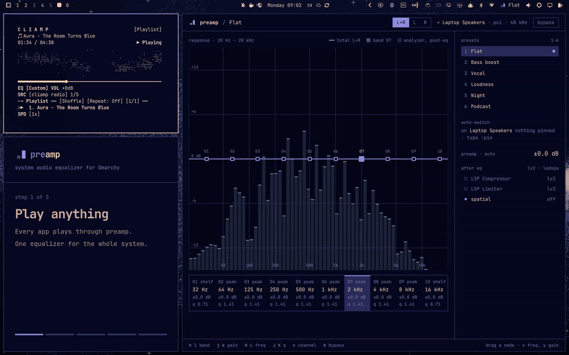
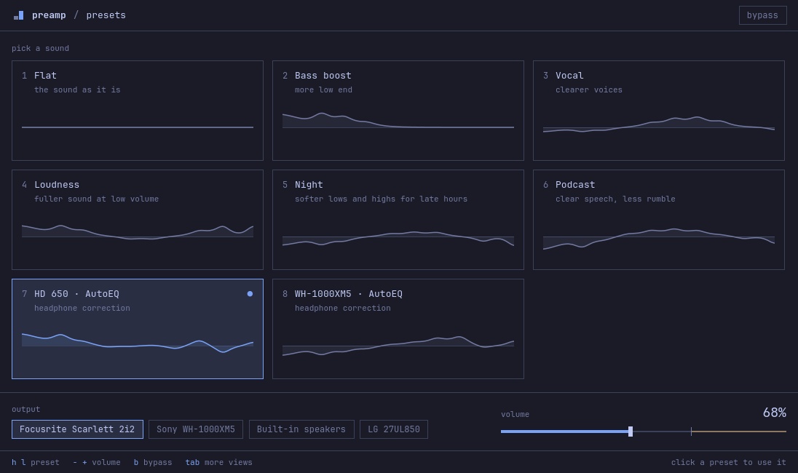
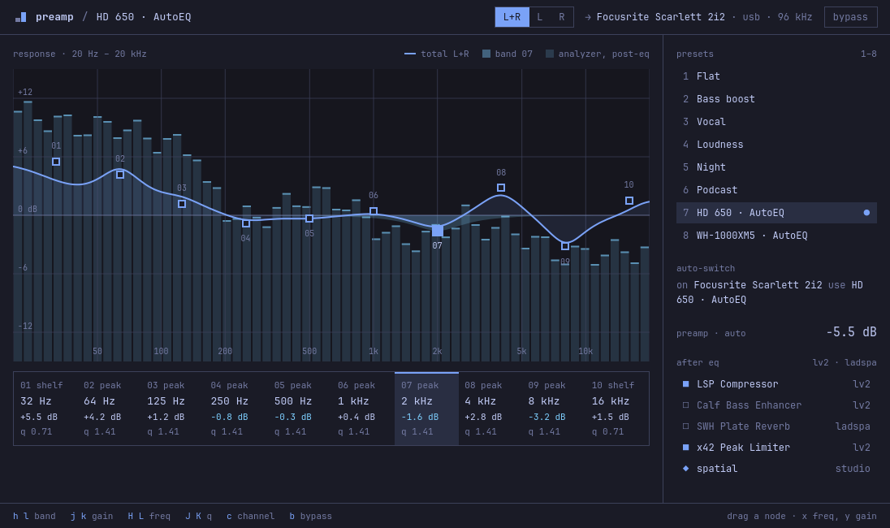
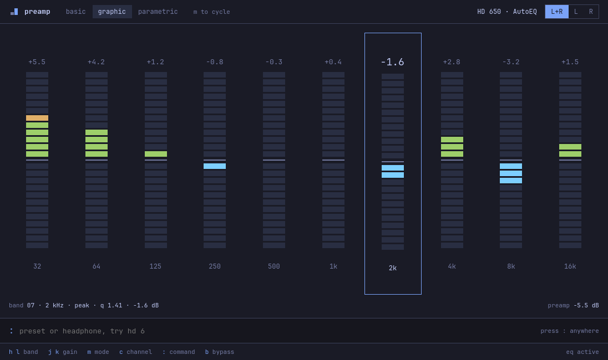
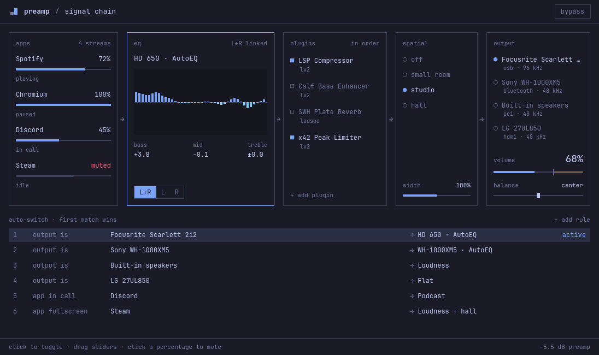

# preamp

[](docs/preamp.mp4)

preamp is a system audio equalizer for [Omarchy](https://omarchy.org). Every app plays through it into your speakers or headphones. Pick a preset from the bar, shape ten bands in the window, or load a correction curve for your headphones. The window and the bar widget follow your Omarchy theme, rounding and language.

To see it with sound, watch the [25-second video](docs/preamp.mp4).

## Install

You need Omarchy 4.0.6 or later, with the Omarchy shell, PipeWire and WirePlumber.

To install the release package:

```sh
curl -LO https://github.com/bjarneo/preamp/releases/download/v0.1.3/preamp-0.1.3-1-x86_64.pkg.tar.zst
sudo pacman -U preamp-0.1.3-1-x86_64.pkg.tar.zst
systemctl --user enable --now preamp.service
preamp shell install
```

`pacman` installs the dependencies. The service starts now and at each login. The last command puts the preamp widget on the Omarchy bar.

To build from source, to add a key that opens the window, to update or to uninstall, see [Install](docs/install.md).

### Install with an agent

A coding agent on your machine can do the install for you. Paste this prompt into Claude Code, Codex, opencode or another agent:

```text
Install preamp, the system audio equalizer for Omarchy, on this machine.
Follow "Steps for agents" in https://github.com/bjarneo/preamp/blob/main/docs/install.md.
Ask me before you run a command that needs root.
When you finish, run `preamp status` and show me the output.
```

## Start in one minute

1. Click the preamp widget in the bar, then click `Bass boost`. The sound changes at once.
2. Right-click the widget to bypass the equalizer. Right-click again to hear the difference.
3. To correct your headphones, run `preamp autoeq "hd 650"` with the name of your model.
4. Open preamp from the app launcher, then press `tab` for the detailed views.

## Features

- A ten-band parametric equalizer for each channel. Edit L and R together or apart.
- An automatic preamp. It cuts the input so that the loudest point of the curve stays at 0 dB.
- A live analyzer of the signal after the equalizer.
- Twelve built-in presets and your own presets. Keys `1` to `6` apply the everyday presets. Keys `7` and `8` apply the other presets that you used last.
- Headphone profiles from [AutoEq](https://github.com/jaakkopasanen/AutoEq), with more than 6,000 headphones.
- LV2 and LADSPA effects after the equalizer, for example a compressor or a limiter from `lsp-plugins-lv2`.
- A room reverb, stereo width and balance.
- Volume up to 150%, and volume and mute for each app.
- Auto-switch rules. A preset can follow an output, an app in a call, or a fullscreen app.
- A notification when preamp moves to a new output.
- A command and a socket command for every action, for scripts and coding agents.
- 50 languages, the same set as Omarchy.

## Views

The presets view is the everyday view. It shows one card for each preset with the shape of its curve, and the output and volume below the cards. Click a card or press its number to use the preset.



Press `tab` to go to the next view. Studio, Modes and Signal chain have the detailed controls. The window opens on the view you used last.

| Studio | Modes | Signal chain |
|---|---|---|
|  |  |  |
| The curve over the analyzer, the ten bands, presets and effects | Basic, graphic and parametric editing, and the command bar | Apps, equalizer, effects, room and output in the order the audio flows, and the auto-switch rules |

## Documentation

| Page | What it covers |
|---|---|
| [Install](docs/install.md) | The package, a build from source, the install with an agent, a key for the window, updates and removal |
| [Presets and headphone profiles](docs/presets.md) | The twelve presets, AutoEq, your own presets, pins and auto-switch rules |
| [The window](docs/window.md) | The four views, the keys, the command bar, channels and bypass |
| [Bar widget](docs/bar-widget.md) | The widget, the popover, its keys and its settings |
| [Output, effects and room](docs/effects.md) | Outputs, volume, app volume, LV2 and LADSPA effects, width, room and balance |
| [Command line](docs/command-line.md) | Every command, with examples for scripts, key bindings and agents |
| [Socket protocol](docs/ipc.md) | The JSON protocol of the service, for your own programs |
| [How it works](docs/how-it-works.md) | The service, the audio path, realtime priority and the files |
| [Troubleshooting](docs/troubleshooting.md) | No sound, broken-up audio, Bluetooth quality and the known issues |
| [Development](docs/development.md) | Build, tests, source layout, a test daemon and releases |

## Known issues

- On a laptop with an Omarchy speaker tuning, the Omarchy volume keys change the volume of the tuning, not of the speakers. If the sound is too quiet, set the volume in preamp, for example `preamp volume 60`. The fix for Omarchy is in [omacom/omarchy#16687](https://github.com/omacom/omarchy/pull/16687).
- Omarchy on x86_64 does not install `rtkit`, so audio can break up when the computer is busy. See [Troubleshooting](docs/troubleshooting.md#audio-breaks-up-when-the-computer-is-busy).
- The Signal chain view needs a window that is 1096 pixels wide or more.

## License

MIT. See [LICENSE](LICENSE).
